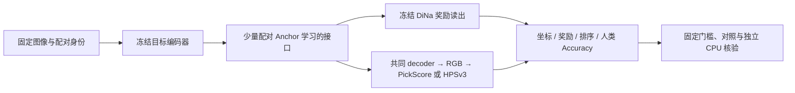
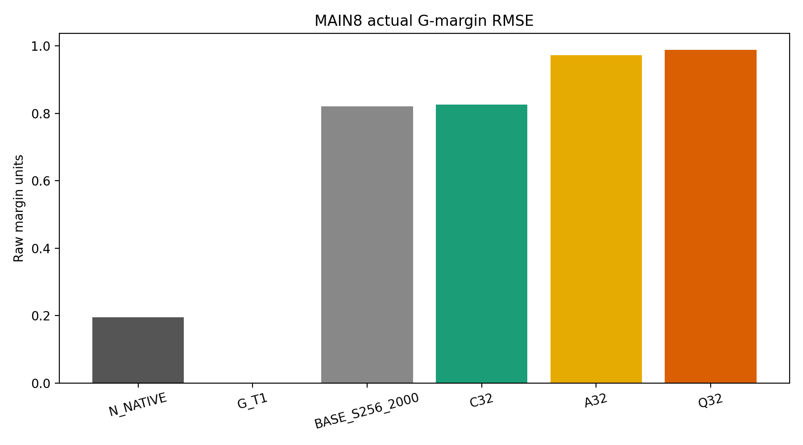

> 历史首页：保留自2026-10-21整理前的main，研究结果范围截至2026-10-10；当前入口见[首页](../../README.md)。

# LatentAtlas：有限配对样本下的跨编码器功能恢复

LatentAtlas 研究能否用少量配对样本学习轻量接口（Projector），让冻结的潜空间奖励模型读取其他编码器的表示，并恢复下游偏好行为。本仓按实验室模板整理已有实验、配置摘要、数值结果和审计证据；本次整理不产生新训练或科学评分。

快速入口：[Related Work：六篇重点论文与科研分析](../related_work/README.md) · [完整实验索引](../experiments/index.md) · [逐次实验日志](../experiment_log.md) · [主要结果总表](../../results/tables/experiment_summary.csv) · [证据与复现说明](../evidence-and-reproduction.md) · [当前任务](../../TODO.md)。

# 1. Problem

冻结的奖励读出依赖原编码器的潜空间坐标。换用 FLUX、Cosmos 或 DC-AE 表示后，形状兼容不等于偏好行为兼容。需要区分：编码器保留了哪些任务信息、接口能恢复多少，以及坐标误差改善是否真的转化为奖励与排序改善。

研究问题是有限配对信息下的跨编码器功能恢复（cross-encoder functional recovery），不是证明所有编码器均可无损互换。

# 2. Core Idea

冻结编码器和奖励读出，用少量配对 Anchor 训练接口；同时报告坐标恢复、奖励误差、偏好准确率及对照条件，从实际任务行为判断接口效果。

# 3. Why It Matters

- 奖励模型复用可减少重复训练，但需要明确来源、目标和读出合同。
- 坐标重建好、FIT 线性近似好，并不保证真实前向或人类偏好指标更好。
- 注册对照、相同信息量 baseline 和独立核验使正面结果与失败都可追溯；目前仍缺少完整的预算匹配和独立确认。

# 4. Method Overview



DiNa 潜空间读出和经 decoder 的 RGB 读出是不同评估路径，不能拼成一个主终点。数学例和规定模型验证单独归档，不能当作真实视觉增益。

# 5. Current Status

- [x] Idea
- [x] Running baseline
- [x] Improving method
- [ ] Writing paper
- [ ] Finished

截至 2026-10-10，归档 **87 条实验/审计记录**：73 条视觉或接口历史记录、14 条理论或规定模型记录；17 项主要实验对照最终报告整理。其余 70 条标记 `WIKI_SNAPSHOT_NOT_REAUDITED`，保留原记录但不声称本次重验全部原始工件。

原 Q32 MICRO 保持 `LOCAL_METHOD_NUMERICALLY_UNQUALIFIED`。后来独立的新协议前向审计实际完成 VAL 和 MAIN8，结论为 **`MAIN8_TRADEOFF_OR_DETERIORATION`**；该候选修复线已停止，不能用新协议抹去原 FD 失败。R18规定模型MVP为 `MIXED`；随后真实DiNa缓存选图pilot为 **`NO_GAIN`**。这些是今日已有结果的补充归档，不是本次提交新执行的实验。

# 6. Key Results

以下各行采用各自固定面板与原统计口径，**不构成跨数据集排行榜**。完整范围、配置、区间和限制见对应记录。

| 实验 / 面板 | 主要实际结果 | 结论与边界 |
| --- | --- | --- |
| [DiNa SRC0](../experiments/latentatlas-dina-src0-source-domain-parity.md)，14,400 对 / 400 组 | Accuracy 74.4451%，中央90%区间 [73.5972%,75.2715%] | 来源域操作性资格；不是精确论文复现 |
| [外部 SHIFT0](../experiments/latentatlas-dina-shift0-dataset-runtime-localization.md)，2,619 对 | Accuracy 51.3860% | 来源到外部的偏好迁移失败证据保留 |
| [Cosmos 固定配方](../experiments/latentatlas-dina-unseen-encoder-fixed-recipe-portability.md)，开发集1,008 对 / 28 组 | REC 72.6190%，Native 72.8175%；NOREG 44.6181%，PERM 49.0823% | 原注册容忍标准下近原生复用通过；是目标接口训练和已使用开发面板，不是零样本或新总体确认 |
| [DC-AE Anchor64→256](../experiments/latentatlas-dina-dcae-strong-anchor64-vs256-fixed2k-newgroups.md)，2,016 对 / 56 组 | NMSE .296255→.210021；Accuracy 68.5392%→69.9529%；G一致率85.8771%→88.6930% | 单次嵌套 Anchor 扩展的联合增益；未近原生、未独立总体确认 |
| [HPSv3 六臂](../experiments/latentatlas-hpsv3-frozen-interface-reuse.md)，1,008 对 / 28 组 | O/N/F_REC/C_REC Accuracy 76.091%/75.298%/73.413%/74.702% | 两个 REC 保留结论均未确立；F_NOREG 协议不兼容缺席，不能称七臂完整 |
| [R18真实缓存选图](../experiments/r18-dina-real-visual-pilot-20261010.md)，旧28组 / 252图 | V2对原生四流人类胜率37.86%，对同标签Logistic38.13%；两项97.5%区间上界均45.98% | NO_GAIN；旧数据回顾性交叉拟合，独立确认B未运行 |
| [Q32 原 MICRO](../experiments/latentatlas-dcae-q32-lowcost-main8.md) | FD 比值1.0865105 > .20；FIT线性误差 .1201572 < .25 | 原 E1 失败；原协议 E2/MAIN8 未运行 |
| [固定候选新协议审计](../experiments/latentatlas-frozen-candidate-forward-audit.md)，固定MAIN8的288 对 / 8 组 / 四流 | Q32 相对 BASE 的 G-margin MSE **增加44.7618%**；调整后的相对改善区间 [-79.6952%,-20.6238%] | 退化得到支持；Q32 优于同信息 A32 未确立，C32 的教师误差更好（二级未调整比较） |


MAIN8 同面板对比（Accuracy 越高越好，G-margin MSE 越低越好）：

| 方法 | Accuracy | G 一致率 | G-margin MSE | 坐标 MSE |
| --- | ---: | ---: | ---: | ---: |
| N_NATIVE | 73.9583% | 97.1229% | .038061 | 不适用 |
| G_T1 | 73.9583% | 100% | 0（自比较） | 0（自比较） |
| BASE S2562000 | 70.4861% | 90.7149% | .674523 | .203078 |
| C32 | 70.5729% | 90.5841% | .682346 | .202794 |
| A32 | 68.7500% | 88.2738% | .945915 | .230457 |
| Q32 | 69.6181% | 88.0122% | .976451 | .234673 |

数值来自 [MAIN8 原结果 JSON](../../results/evidence/q32-forward/MAIN8_RESULTS.json)，完整精度与区间保存在 [CSV](../../results/tables/q32_main8.csv) 和 [主效应 CSV](../../results/tables/q32_main8_effects.csv)。Accuracy 的变化区间跨0，不能因点估计下降就写成已支持的人类 Accuracy 退化。



VAL 曾出现9.3826%的 Q32 中心化风险点改善，但普通双侧95%区间跨0；固定单侧行动门槛通过仅允许进入 MAIN8，不证明泛化增益。VAL 没有人类 Accuracy，也不是独立测试集。见 [VAL 数值](../../results/tables/q32_val.csv) 与 [实际效用图](../../results/figures/q32-forward/VAL_centered_risk.png)。

R18数值与照片见[真实pilot记录](../experiments/r18-dina-real-visual-pilot-20261010.md)、[原汇报](../reports/r18-dina-real-visual-pilot-20261010-final.txt)与[固定照片面板](../../results/figures/r18-visual/photo-cases.png)。原运行summary中的图片缺失是补图前历史时点；最新8/8核验见[照片回执](../../results/evidence/r18-visual/PHOTO_VERIFICATION.json)，不将其他244图写成已下载。R18模拟主格53.8% KL改善仅限[规定模型MVP](../experiments/r18-method-mvp-20261010.md)，不抵消真实NO_GAIN。

# 7. Next Step

- 补齐可共享的原始工件存储位置与模型/数据许可说明。
- 以相同配对信息与预算的简单 baseline、独立面板和机制干预核对后续主张；当前不宣称论文级独立确认。
- 后续执行需要单独的实验协议；此 PR 不恢复停止的 Q32 线、不启动新研究或 GPU 任务。

# 8. How to Reproduce

Python 3.9+，仅标准库，无需 GPU 或模型下载：

```bash
bash scripts/reproduce.sh
```

这会校验仓内工件 SHA、来源与记录索引，并从已归档结果 JSON **重建并核对发表结果表**。它不重跑训练、奖励模型或原始 bootstrap。完整原始 CPU 回放和 GPU 重现所需外部工件及限制见 [复现说明](../evidence-and-reproduction.md)。原独立 CPU 验收回执已归档，但不冒充本次新执行的科学核验。

# 9. Maintainer

Name: YEGRX
Last update: 2026-10-10
Source inventory: [source_manifest.json](../../results/source_manifest.json)
